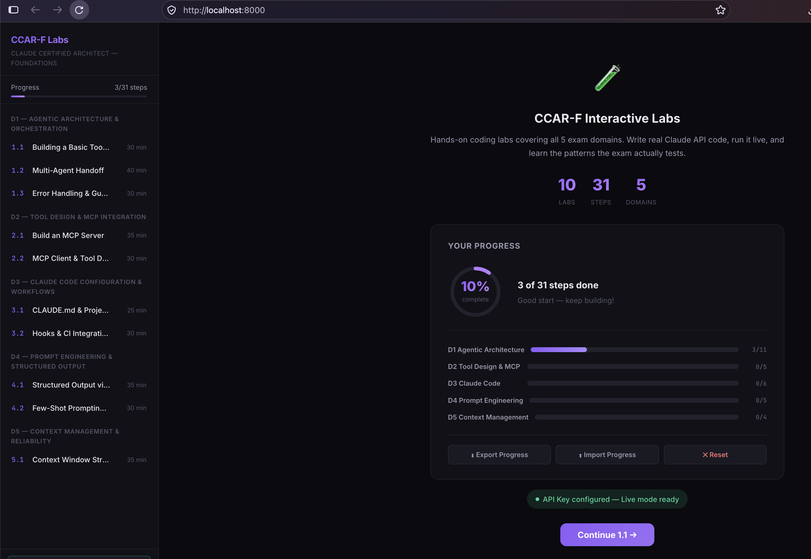
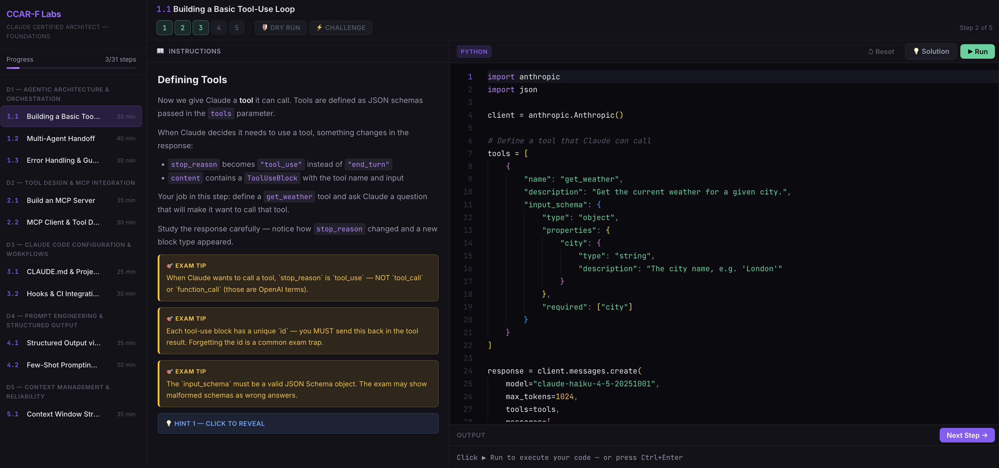
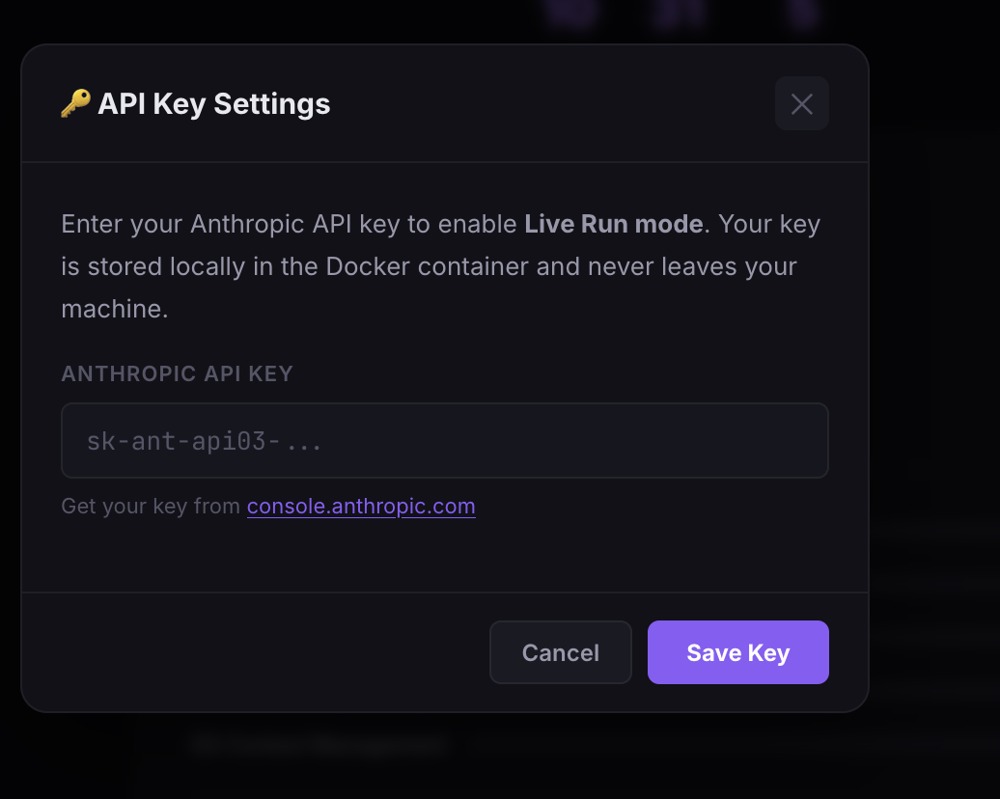

# CCAR-F Interactive Labs

> Hands-on coding labs for the **Claude Certified Architect &mdash; Foundations (CCAR-F)** exam.

Write real Claude API code, run it live or in dry-run mode, and master the patterns the exam actually tests &mdash; all from a local Docker environment with a polished, dark-themed IDE.



---

## What's Inside

| Domain | Weight | Labs | Steps |
|--------|--------|------|-------|
| D1 &mdash; Agentic Architecture & Orchestration | 27% | 3 | 11 |
| D2 &mdash; Tool Design & MCP Integration | 18% | 2 | 5 |
| D3 &mdash; Claude Code Configuration & Workflows | 20% | 2 | 6 |
| D4 &mdash; Prompt Engineering & Structured Output | 20% | 2 | 5 |
| D5 &mdash; Context Management & Reliability | 15% | 1 | 4 |
| **Total** | **100%** | **10** | **31** |

---

## Features

### Interactive Lab Environment

Each lab comes with step-by-step instructions, a built-in Monaco code editor, exam tip callouts, and hints. Write your code on the right, read instructions on the left, and run everything in-browser.



### Dry Run Mode

Study without spending a cent. Every step includes realistic pre-built output so you can learn the concepts, understand response structures, and practice patterns &mdash; no API key required.

### Challenge Mode

Hide the starter code and write your solution from scratch. Great for testing yourself before the exam.

### Progress Dashboard

Track your completion across all 5 domains with an animated progress ring and per-domain bars. The dashboard shows exactly where you stand and which domain to focus on next.

### Session Export / Import

Your progress is stored in the browser. Use **Export Progress** to save it to a JSON file and **Import Progress** to restore it later &mdash; so you never lose your work if you rebuild the container or switch browsers.

### API Key Management

Set your Anthropic API key directly from the UI. No need to edit config files.



---

## Quick Start

### Prerequisites

- [Docker Desktop](https://docs.docker.com/get-docker/) installed and running
- Python 3.8+ (for the deploy script)
- (Optional) An [Anthropic API key](https://console.anthropic.com/settings/keys) for live mode

### One-Command Deploy

```bash
# Clone the repo
git clone https://github.com/moizl599/Claude-Certified-Architect-Foundations_LAB.git
cd Claude-Certified-Architect-Foundations_LAB

# Deploy (dry-run mode, no API key needed)
python deploy.py

# Or deploy with your API key for live mode
python deploy.py --key sk-ant-your-key-here
```

The deploy script will:
1. Check that Docker is installed and running
2. Build the Docker image
3. Start the container
4. Open `http://localhost:8000` in your browser

### Manual Setup (without deploy script)

```bash
# Create .env file
echo "ANTHROPIC_API_KEY=sk-ant-xxxxx" > .env

# Build and start
docker compose up --build -d

# Open in browser
open http://localhost:8000
```

---

## Usage

### Getting Started

1. Open `http://localhost:8000` in your browser
2. Click **Start Lab 1.1** on the welcome screen
3. Read the instructions on the left panel
4. Write or modify the code in the Monaco editor
5. Click **Run** (or press `Ctrl+Enter`) to execute

### Modes

| Mode | Description |
|------|-------------|
| **Dry Run** (default) | Uses pre-built output. No API key or cost. |
| **Live Mode** | Executes real API calls. Requires an Anthropic key. |
| **Challenge Mode** | Hides starter code. Write everything from scratch. |

### Setting Your API Key

You can set your API key in two ways:
- **UI**: Click the key button in the sidebar, or use the health badge on the welcome screen
- **CLI**: `python deploy.py --key sk-ant-your-key-here`

### Saving Progress

Progress is stored in your browser's localStorage and persists across container restarts.

For a portable backup:
1. Click **Export Progress** on the dashboard to download a JSON file
2. To restore, click **Import Progress** and select your saved file

---

## CLI Reference

```
python deploy.py                    # Build and launch (dry-run mode)
python deploy.py --key sk-ant-...   # Launch with API key
python deploy.py --stop             # Stop containers
python deploy.py --rebuild          # Force clean rebuild
python deploy.py --status           # Check if labs are running
python deploy.py --no-browser       # Deploy without opening browser
```

---

## About the CCAR-F Exam

| Detail | Value |
|--------|-------|
| Format | 60 scenario-based multiple choice questions |
| Duration | 120 minutes |
| Passing Score | 720 / 1000 |
| Cost | $125 |

The exam tests practical knowledge of building production systems with Claude &mdash; not trivia. These labs mirror the exact patterns and concepts that appear on the exam.

---

## Tech Stack

- **Backend**: Python / FastAPI
- **Frontend**: Vanilla HTML/CSS/JS + Monaco Editor
- **Container**: Docker / Docker Compose
- **Editor**: Monaco Editor v0.45.0 (VS Code's editor)

---

## Cost

All labs default to **Claude Haiku**, the cheapest model. A full run through every lab in live mode costs roughly **$0.30 &ndash; $0.50**. Dry-run mode costs nothing.

---

## License

MIT

---

Built for the Claude Certified Architect community.
